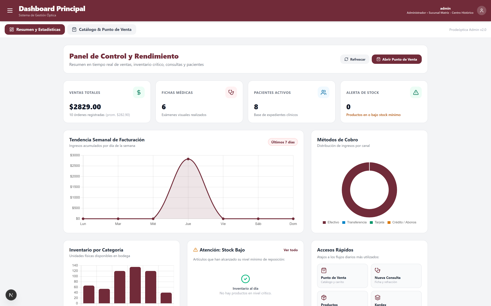
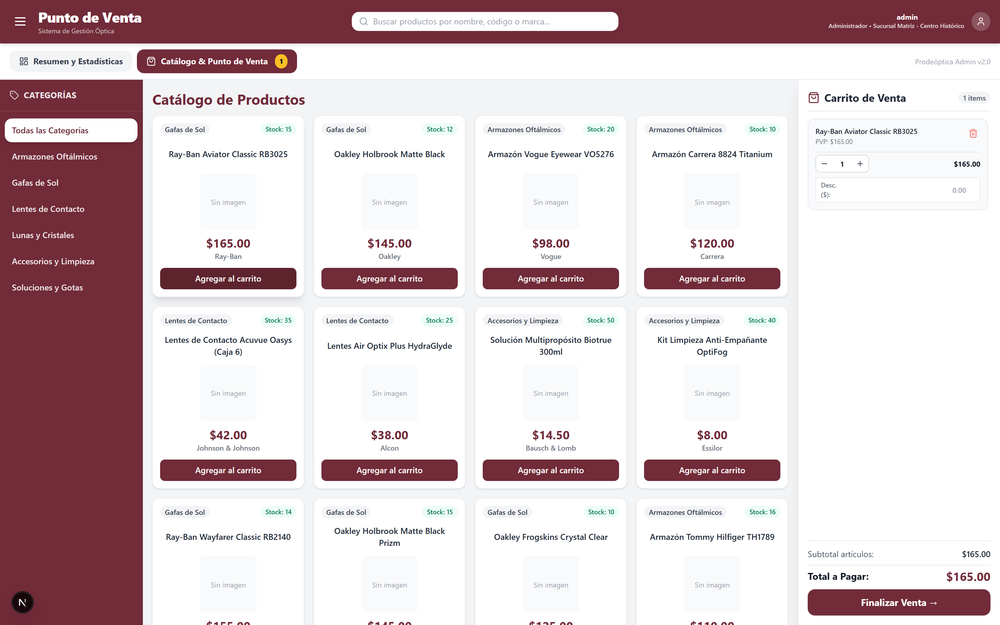
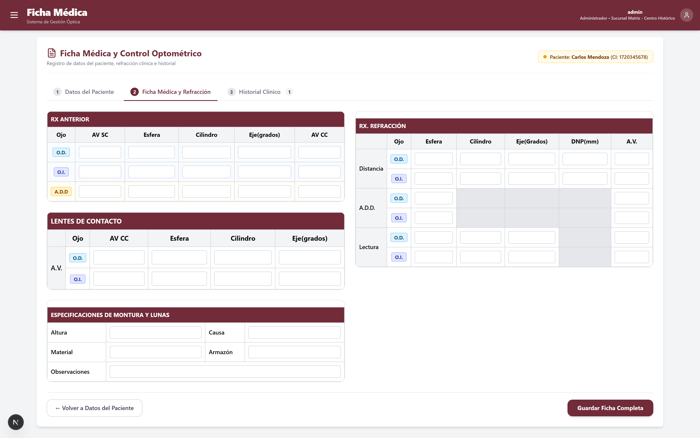
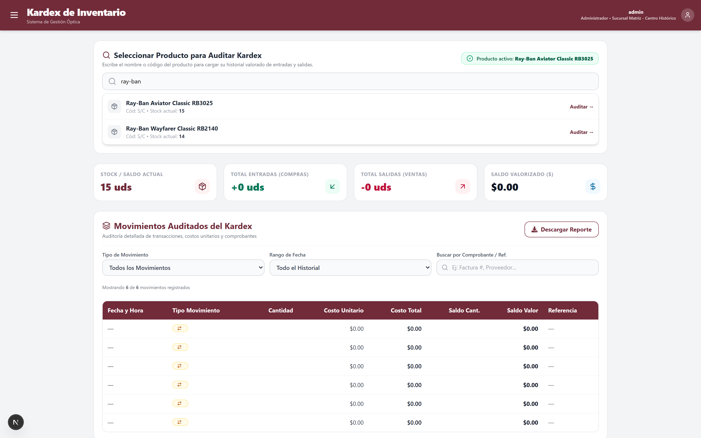

# Prodeóptica - Workspace Raíz

Workspace integrado para el sistema **Prodeóptica**, compuesto por:

- **Frontend:** [`frontend-prodeoptica/`](./frontend-prodeoptica) (Next.js)
- **Backend:** [`backend-prodeoptica/`](./backend-prodeoptica) (Django REST Framework)

## Estructura del Proyecto

```text
Optica/
├── .gitmodules
├── Optica.code-workspace
├── capturas/                   (Galería de capturas para portafolio)
├── frontend-prodeoptica/       (Submódulo Git)
└── backend-prodeoptica/        (Submódulo Git)
```

---

## 📸 Demo & Capturas de Portafolio

Puedes consultar la galería completa con descripciones técnicas detalladas en [`capturas/`](./capturas/README.md).

| Dashboard Ejecutivo con KPIs & Chart.js | Punto de Venta (POS) & Facturación |
| :---: | :---: |
|  |  |

| Ficha Médica y Control Optométrico | Auditoría de Kardex Valorizado |
| :---: | :---: |
|  |  |

*Explora todas las capturas (Login, Inventario, Abonos, Ingresos, CRUD y Navegación) en la carpeta [`capturas/`](./capturas).*

---

## Clonación con submódulos

Para clonar este repositorio completo en otra máquina utilizando la cuenta personal de GitHub:

```bash
git clone --recurse-submodules git@github-personal:MatiasG2377/prodeoptica.git
```

Si ya se clonó sin submódulos:

```bash
git submodule update --init --recursive
```

---

## 🚀 Cómo Ejecutar el Proyecto

El proyecto requiere dos terminales activas simultáneamente: una para el **Backend** y otra para el **Frontend**.

### 1. Terminal 1: Backend (Django REST Framework)

El entorno virtual se ubica en `backend-prodeoptica/venv` y el código del servidor en `backend-prodeoptica/REST_API_OPTICA`.

1. Entra a la carpeta del backend:
   ```powershell
   cd backend-prodeoptica
   ```

2. Activa el entorno virtual:
   - **PowerShell:**
     ```powershell
     .\venv\Scripts\Activate.ps1
     ```
     *(Si PowerShell restringe scripts: `Set-ExecutionPolicy -Scope Process -ExecutionPolicy Bypass`)*
   - **CMD:**
     ```cmd
     .\venv\Scripts\activate.bat
     ```
   - **Bash / Git Bash:**
     ```bash
     source venv/Scripts/activate
     ```

3. Dirígete a la carpeta donde está `manage.py`:
   ```powershell
   cd REST_API_OPTICA
   ```

4. *(Opcional)* Aplica migraciones y puebla la base de datos con seeders completos:
   ```powershell
   python manage.py migrate
   python manage.py seed
   ```

5. Inicia el servidor de desarrollo:
   ```powershell
   python manage.py runserver
   ```

> 📍 **Acceso Backend:**
> - Servidor: [http://127.0.0.1:8000/](http://127.0.0.1:8000/)
> - API Base: [http://127.0.0.1:8000/api/](http://127.0.0.1:8000/api/)
> - Panel Admin: [http://127.0.0.1:8000/admin/](http://127.0.0.1:8000/admin/) (Usuario: `admin` / Contraseña: `admin`)

---

### 2. Terminal 2: Frontend (Next.js)

1. En una nueva terminal, entra a la carpeta del frontend:
   ```powershell
   cd frontend-prodeoptica
   ```

2. Configura las variables de entorno creando un archivo `.env.local` con la URL del backend:
   - **PowerShell:**
     ```powershell
     New-Item -ItemType File -Name ".env.local" -Value "NEXT_PUBLIC_API_URL=http://127.0.0.1:8000/api`n" -Force
     ```
   - O crea manualmente el archivo `frontend-prodeoptica/.env.local`:
     ```env
     NEXT_PUBLIC_API_URL=http://127.0.0.1:8000/api
     ```

3. Instala las dependencias de Node:
   ```powershell
   npm install
   ```

4. Inicia el servidor de desarrollo:
   ```powershell
   npm run dev
   ```

> 📍 **Acceso Frontend:**
> - Aplicación web: [http://localhost:3000](http://localhost:3000)
