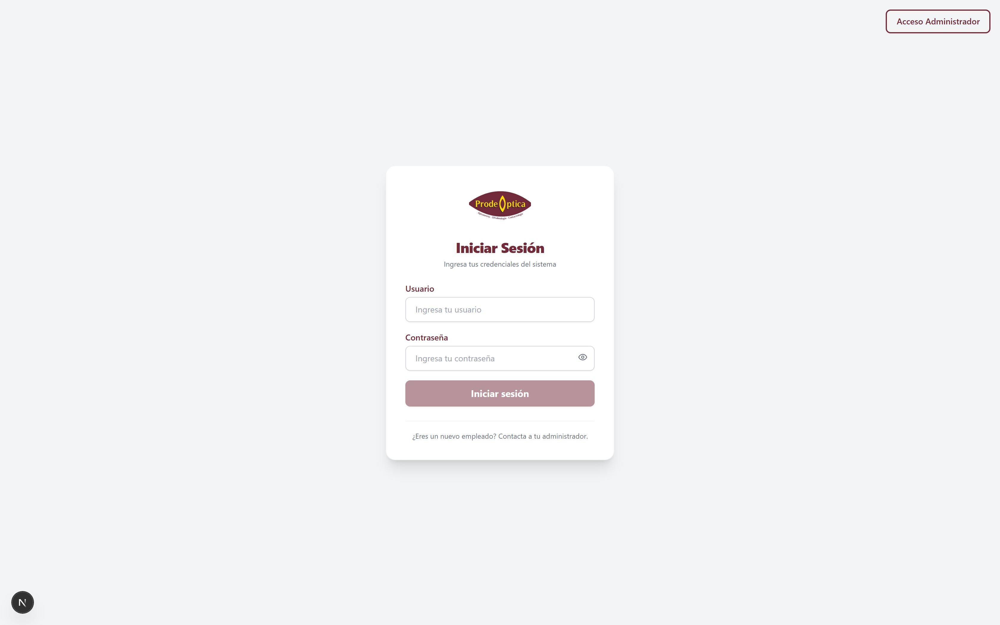
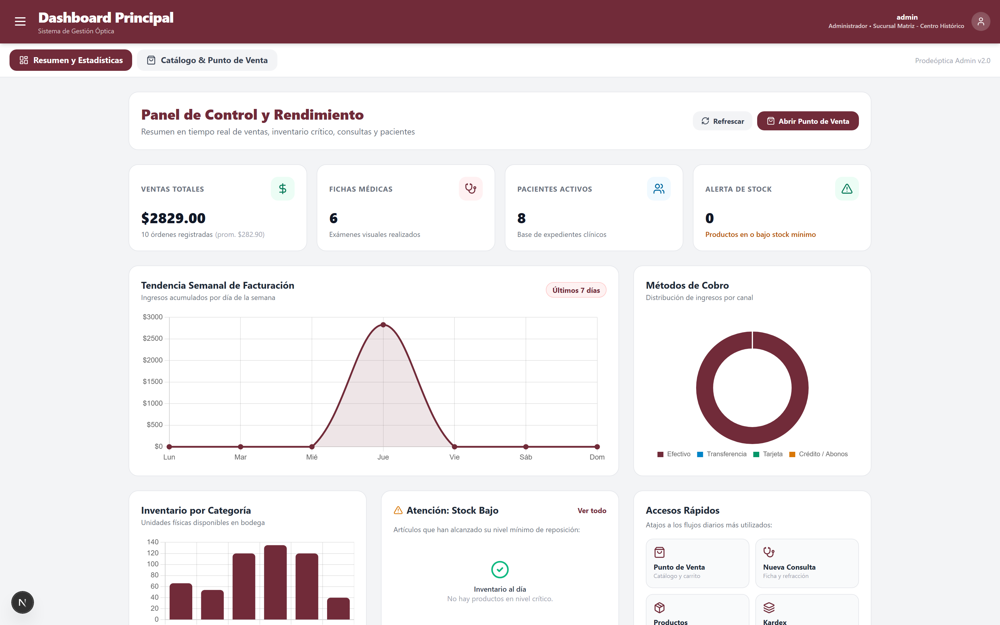
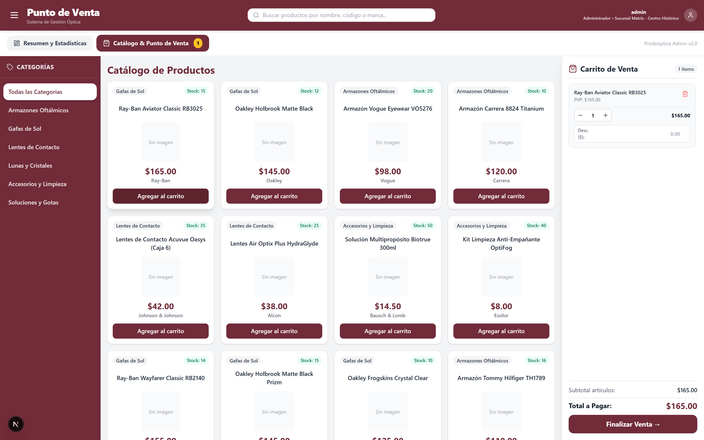
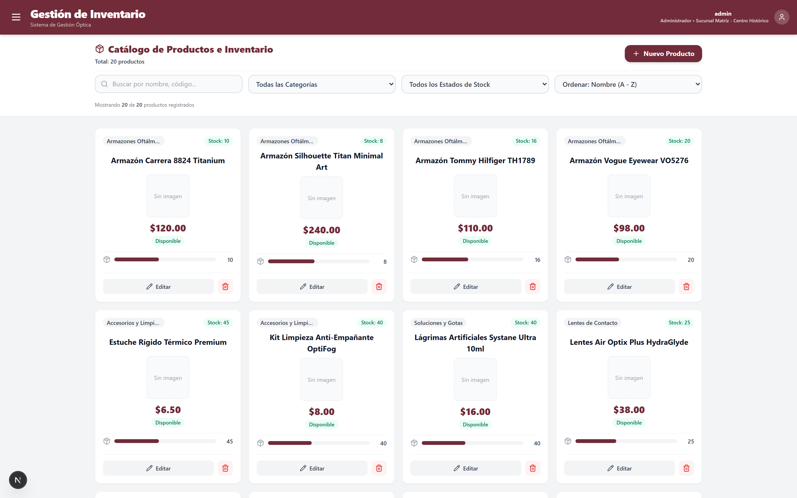
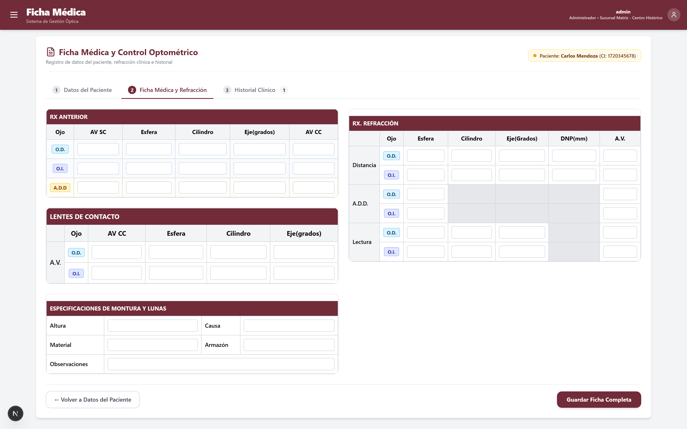
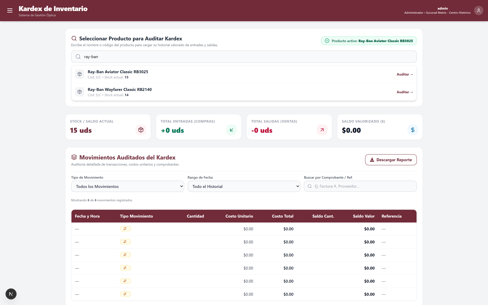
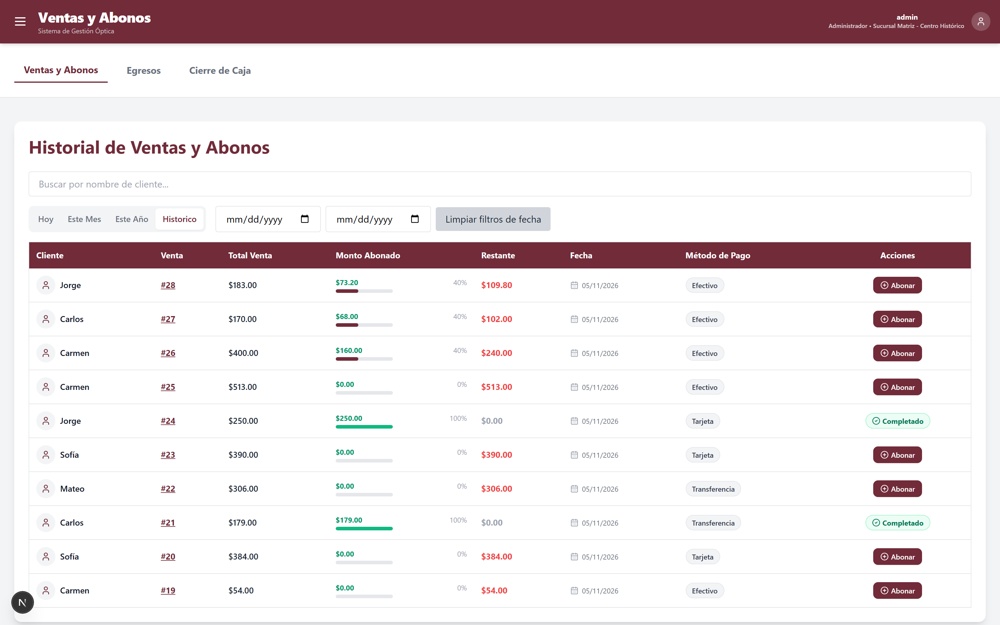
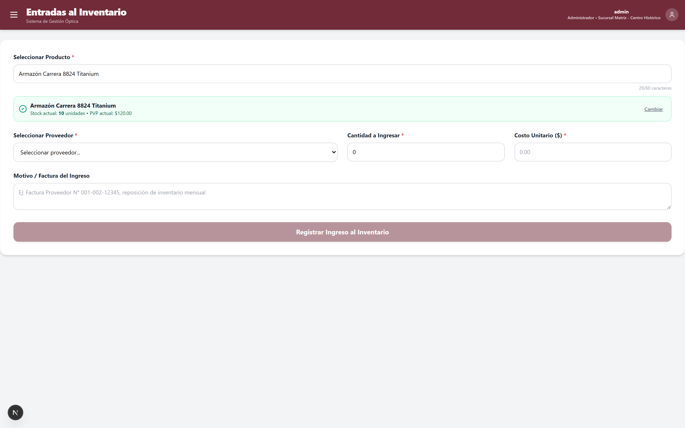
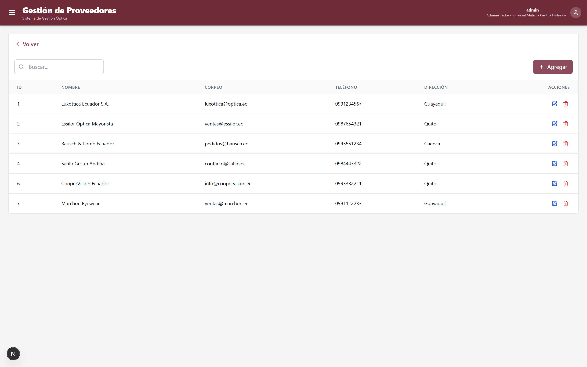
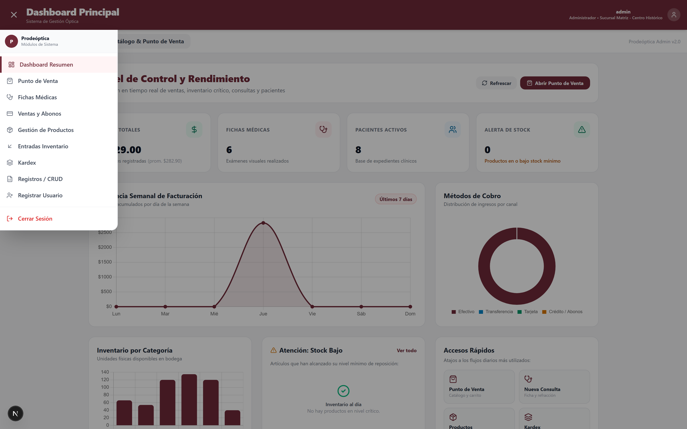

# 📸 Galería Demo y Capturas del Sistema — Prodeóptica

> Colección visual de capturas en alta resolución (**1680x1050 @2x**) para demostración y portafolio profesional. Cada vista ilustra el funcionamiento integral del sistema utilizando la base de datos local y datos realistas generados con seeders.

---

### 1. Inicio de Sesión y Autenticación JWT
Acceso seguro con control de roles (Administrador, Gerente, Vendedor) y diseño responsivo.

---

### 2. Panel Ejecutivo y Analítica en Tiempo Real
Dashboard gerencial con KPIs de ventas, pacientes atendidos, métricas de refracción, gráficas interactivas con Chart.js (tendencia semanal y distribución por canal) y alertas de inventario.

---

### 3. Punto de Venta (POS) y Facturación
Terminal de venta ágil con filtrado por categorías de productos (Armazones, Gafas de Sol, Lentes de Contacto, Lunas), buscador en tiempo real, control de stock y carrito lateral con cálculo automático de totales y descuentos.

---

### 4. Catálogo y Gestión de Inventario
Vista de productos con indicadores de stock mínimo/máximo, barras de nivel de existencias, filtros por categorías y opciones de edición/creación rápida.

---

### 5. Ficha Médica y Control Optométrico (Refracción)
Historia clínica digital especializada para ópticas: refracción binocular completa (Ojo Derecho y Ojo Izquierdo con esfera, cilindro, eje, DNP, adición y agudeza visual), lentes de contacto y especificaciones de montura.

---

### 6. Kardex y Trazabilidad de Movimientos
Auditoría valorizada de inventario por producto con cálculo de saldo físico, saldo en dólares, histórico detallado de compras, ventas y ajustes con referencia de facturas.

---

### 7. Gestión de Ventas a Crédito y Abonos
Control de cuentas por cobrar, seguimiento de cuotas de pago con barra de progreso porcentual, desglose de métodos de cobro y registro de recibos de caja.

---

### 8. Registro de Ingresos de Mercadería
Formulario de abastecimiento y compras a proveedores/laboratorios con cálculo en vivo de stock proyectado, costo total e ingreso de número de factura/lote.

---

### 9. Administración y Mantenimiento (CRUDs)
Gestión centralizada de maestros del sistema (Proveedores, Laboratorios, Sucursales, Categorías) con validaciones y acciones en tiempo real.

---

### 10. Navegación Global y Perfil de Usuario
Menú lateral tipo drawer que interconecta todos los módulos del ERP óptico con persistencia de sesión activa.

