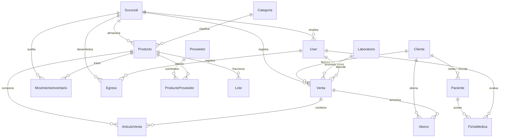

# Data Model: Prodeóptica - Esquemas y Entidades Clave

## 1. Diagrama Entidad-Relación

---

## 2. Definición de Entidades

### `Cliente`
- `id`: Entero (PK)
- `ci_cliente`: Texto (10 dígitos en Ecuador o 13 RUC)
- `nombre_cliente`: Texto
- `apellido_cliente`: Texto
- `correo_cliente`: Email (único)
- `telefono_cliente`: Texto
- `direccion_cliente`: Texto
- `informacion_cliente`: Texto (notas)

### `Paciente`
- `id`: Entero (PK)
- `cliente`: FK -> `Cliente` (opcional/tutor)
- `ci_paciente`: Texto (identificación del examinado)
- `nombres_paciente`: Texto
- `apellidos_paciente`: Texto
- `fecha_nacimiento`: Fecha
- `ocupacion_paciente`: Texto
- `direccion_paciente`: Texto
- `telefono_paciente`: Texto
- `antecedentes_paciente`: Texto (patologías oculares, diabetes, cirugías)

### `FichaMedica`
- `id`: Entero (PK)
- `paciente`: FK -> `Paciente`
- `usuario`: FK -> `User` (optometrista)
- `sucursal`: FK -> `Sucursal`
- `fecha`: DateTime (auto_now_add)
- `datos_opticos`: JSONB (almacenamiento estructurado de mediciones):
  - `rx_distancia_od_av`, `rx_distancia_od_esfera`, `rx_distancia_od_cilindro`, `rx_distancia_od_eje`, `rx_distancia_od_dnp`
  - `rx_distancia_oi_av`, `rx_distancia_oi_esfera`, `rx_distancia_oi_cilindro`, `rx_distancia_oi_eje`, `rx_distancia_oi_dnp`
  - `rx_add_od_av`, `rx_add_od_esfera`, `rx_add_oi_av`, `rx_add_oi_esfera`
  - `diagnostico`: Diagnóstico clínico
  - `tipo_lente`: Monofocal, Bifocal, Progresivo, Tórico, etc.
  - `material`: Policarbonato, CR-39, Alto Índice, Cristal, etc.
  - `observaciones`: Cuidados y próxima cita

### `Venta`
- `id`: Entero (PK)
- `cliente_venta`: FK -> `Cliente`
- `sucursal_venta`: FK -> `Sucursal`
- `usuario_venta`: FK -> `User`
- `laboratorio_venta`: FK -> `Laboratorio` (opcional)
- `orden_laboratorio`: Texto (código de receta en laboratorio externo)
- `orden_trabajo`: Texto (código interno de taller de corte/montaje)
- `metodo_venta`: CharField ('Efectivo', 'Transferencia', 'Tarjeta')
- `total_venta`: Decimal(10, 2)
- `estado_venta`: CharField ('P' Pendiente, 'F' Finalizada, 'C' Cancelada)
- `fecha_venta`: DateTime

### `ArticuloVenta`
- `id`: Entero (PK)
- `venta_articuloVenta`: FK -> `Venta`
- `producto_articuloVenta`: FK -> `Producto`
- `cantidad_articuloVenta`: Entero (> 0)
- `pvp_articuloVenta`: Decimal(10, 2)
- `descuento_articuloVenta`: Decimal(5, 2) (menor que `pvp * cantidad`)

### `Abono`
- `id`: Entero (PK)
- `venta`: FK -> `Venta`
- `cliente`: FK -> `Cliente`
- `monto`: Decimal(10, 2) (> 0)
- `fecha`: DateTime
- `metodo_pago`: CharField ('Efectivo', 'Transferencia', 'Tarjeta')
- `completado`: Booleano (true cuando la venta queda en saldo 0)

### `Egreso`
- `id`: Entero (PK)
- `monto_egreso`: Decimal(10, 2)
- `descripcion_egreso`: Texto
- `categoria_egreso`: CharField ('Servicios básicos', 'Arriendo', 'Suministros', 'Mantenimiento', 'Otros')
- `metodo_pago_egreso`: CharField ('Efectivo', 'Transferencia', 'Tarjeta')
- `fecha_egreso`: DateTime
- `usuario_egreso`: FK -> `User`
- `sucursal_egreso`: FK -> `Sucursal`

### `MovimientoInventario` (Kardex)
- `id`: Entero (PK)
- `producto_movimientoInventario`: FK -> `Producto`
- `sucursal_movimientoInventario`: FK -> `Sucursal`
- `tipo_movimientoInventario`: CharField ('Entrada', 'Salida')
- `cantidad_movimientoInventario`: Entero (> 0)
- `motivo_movimientoInventario`: Texto
- `fecha_movimientoInventario`: DateTime

