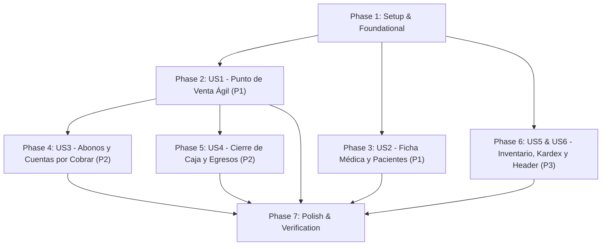

# Tasks: Optimización Integral UI/UX, Ergonomía de Procesos y Facilidad de Uso

**Input**: Documentos de diseño desde `/specs/001-ui-ux-optimization/`
**Prerequisites**: plan.md, spec.md, research.md, data-model.md, contracts/
**Feature Directory**: `specs/001-ui-ux-optimization/`

## Format: `[ID] [P?] [Story] Description`

- **[P]**: Ejecutable en paralelo (archivos independientes sin bloqueo mutuo)
- **[Story]**: Mapeo directo a la User Story de `spec.md` (US1 a US6)
- Rutas de archivo absolutas o relativas al root del workspace

---

## Phase 1: Setup & Foundational Prerequisites

**Purpose**: Infraestructura transversal y componentes base para todas las historias

- [x] T001 Verificar consistencia de modelos, serializers y endpoints en `backend-prodeoptica/REST_API_OPTICA/inventario/API/`
- [x] T002 [P] Crear componente reutilizable de Skeleton Loader en `frontend-prodeoptica/app/components/common/Skeleton.jsx`
- [x] T003 [P] Estandarizar función de feedback y alertas no intrusivas en `frontend-prodeoptica/app/utils/toastAlert.js`

**Checkpoint**: Base de componentes de carga y notificación lista para usarse en todas las pantallas.

---

## Phase 2: User Story 1 - Punto de Venta y Carrito Ágil (Priority: P1) 🎯 MVP

**Goal**: Búsqueda reactiva instantánea, control visual de stock y carrito con subtotales/descuentos reactivos.
**Independent Test**: Buscar producto, agregarlo al carrito, modificar cantidades/descuentos y verificar cálculo reactivo y bloqueo si excede stock.

- [x] T004 [P] [US1] Añadir insignias visuales de stock ("Disponible", "Stock Bajo", "Agotado") y bloqueo si stock = 0 en `frontend-prodeoptica/app/components/dashboard/ProductCard.jsx`
- [x] T005 [US1] Optimizar el hook de catálogo con debounce de 300ms, AbortController y estado de carga tipo skeleton en `frontend-prodeoptica/app/hooks/useDashboard.js`
- [x] T006 [P] [US1] Refinar controles de cantidad (`+`/`-`), teclado y validación estricta de que el descuento no supere el precio bruto en `frontend-prodeoptica/app/components/dashboard/CartSummary.jsx`
- [x] T007 [US1] Garantizar sincronización atómica entre el carrito y el proceso de checkout en `frontend-prodeoptica/app/hooks/useVenta.js`

**Checkpoint**: Flujo de venta en mostrador 100% fluido, sin parpadeos y con validación matemática de descuentos.

---

## Phase 3: User Story 2 - Consulta Rápida y Registro Asistido de Fichas Médicas (Priority: P1)

**Goal**: Búsqueda automática de pacientes por cédula (10 dígitos), captura refractiva asistida e historial colapsable.
**Independent Test**: Digitar cédula en `/ficha-medica`, verificar precarga automática de antecedentes y desplegar fichas previas.

- [x] T008 [P] [US2] Implementar búsqueda reactiva automática al completar 10 dígitos de cédula ecuatoriana en `frontend-prodeoptica/app/ficha-medica/page.jsx`
- [x] T009 [US2] Reorganizar la tabla de refracción óptica (OD / OI) con campos numéricos guiados (pasos de 0.25 dioptrías) y tabulación rápida en `frontend-prodeoptica/app/ficha-medica/page.jsx`
- [x] T010 [P] [US2] Diseñar tarjetas colapsables tipo acordeón para consultas previas en `frontend-prodeoptica/app/components/ficha-medica/FichaVisual.jsx`
- [x] T011 [US2] Conectar la orden de laboratorio de la receta óptica directamente al selector de la venta en `frontend-prodeoptica/app/components/venta/ClienteForm.jsx`

**Checkpoint**: Consulta clínica optométrica asistida, sin desplazamientos innecesarios y con historial claro.

---

## Phase 4: User Story 3 - Gestión Visual de Abonos, Saldos y Cuentas por Cobrar (Priority: P2)

**Goal**: Control visual del estado de pago mediante barra de progreso y cálculo en vivo del saldo restante al abonar.
**Independent Test**: Seleccionar una venta con saldo en `/abonos`, digitar un monto y constatar el cálculo en vivo del saldo restante.

- [x] T012 [P] [US3] Agregar barra de progreso porcentual del saldo cubierto y colores contextuales en `frontend-prodeoptica/app/components/abonos/AbonoFila.jsx`
- [x] T013 [US3] Implementar cálculo interactivo en vivo del nuevo saldo restante y límite preventivo contra sobrepagos en `frontend-prodeoptica/app/components/abonos/AbonoModal.jsx`
- [x] T014 [P] [US3] Enriquecer el modal de historial de abonos con cronología formateada y cajero responsable en `frontend-prodeoptica/app/components/abonos/HistorialAbonosModal.jsx`

**Checkpoint**: Módulo de cobranzas claro, preventivo contra errores de digitación y con auditoría total.

---

## Phase 5: User Story 4 - Arqueo y Cierre de Caja en Vivo con Egresos Racionales (Priority: P2)

**Goal**: Cierre de caja en vivo con filtros de 1 clic ("Hoy", "Este Mes") y discriminación entre efectivo físico y medios electrónicos.
**Independent Test**: Filtrar cierre de caja por "Hoy", asentar un egreso de efectivo y verificar el recálculo inmediato de la Caja Física.

- [x] T015 [P] [US4] Implementar botones de selección de periodo rápido ("Hoy", "Este Mes", "Este Año", "Histórico") en `frontend-prodeoptica/app/components/caja/CierreCajaView.jsx`
- [x] T016 [US4] Refinar la discriminación visual y matemática entre **Total Caja Física** (efectivo en cajón) y **Balance General** en `frontend-prodeoptica/app/components/caja/CierreCajaView.jsx`
- [x] T017 [P] [US4] Simplificar el formulario de egresos rápidos con categorías predefinidas y método de pago en `frontend-prodeoptica/app/components/egresos/EgresosView.jsx`

**Checkpoint**: Arqueo de caja diario exacto, sin hojas de cálculo externas ni demoras al cierre de turno.

---

## Phase 6: User Story 5 & 6 - Inventario, Kardex y Header Unificado (Priority: P3)

**Goal**: Semáforos de stock en catálogo, trazabilidad en Kardex y barra de navegación superior unificada en todo el sistema.
**Independent Test**: Navegar entre todas las pantallas verificando el header idéntico y revisar el historial de entradas/salidas en Kardex.

- [x] T018 [P] [US5] Implementar semáforos de stock (Disponible, Bajo Stock, Agotado) y vista previa de imagen en `frontend-prodeoptica/app/inventario/page.jsx`
- [x] T019 [US5] Mejorar la visualización cronológica con insignias de color de Entrada/Salida en `frontend-prodeoptica/app/kardex/page.jsx`
- [x] T020 [P] [US6] Unificar la barra de navegación superior en `frontend-prodeoptica/app/components/common/Header.jsx` mostrando sucursal activa, usuario, rol y menú modular en todas las rutas

**Checkpoint**: Plataforma estéticamente consistente, con semáforos de stock y trazabilidad transparente.

---

## Phase 7: Polish & Cross-Cutting Concerns

**Purpose**: Verificación cruzada, calidad y pruebas integrales

- [x] T021 Ejecutar la suite automatizada de pruebas de Django: `python manage.py test inventario` (3 tests OK en 0.499s)
- [x] T022 Ejecutar el linter del frontend: `npm run lint` en `frontend-prodeoptica/` (0 errores)
- [x] T023 Validar los escenarios de `quickstart.md` en navegador y registrar checklist de convergencia

---

## Dependencies & Execution Order

